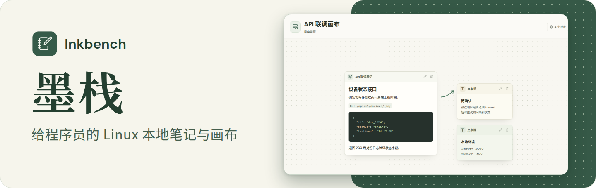
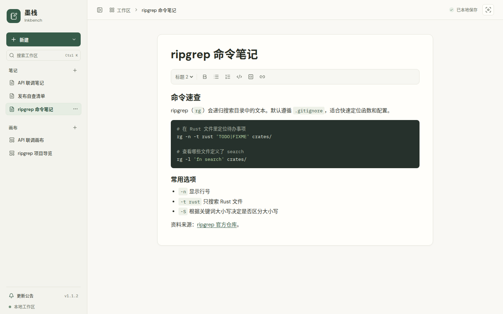
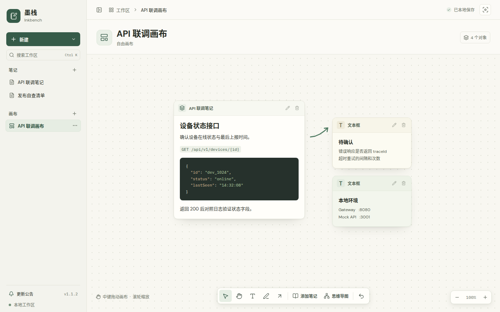
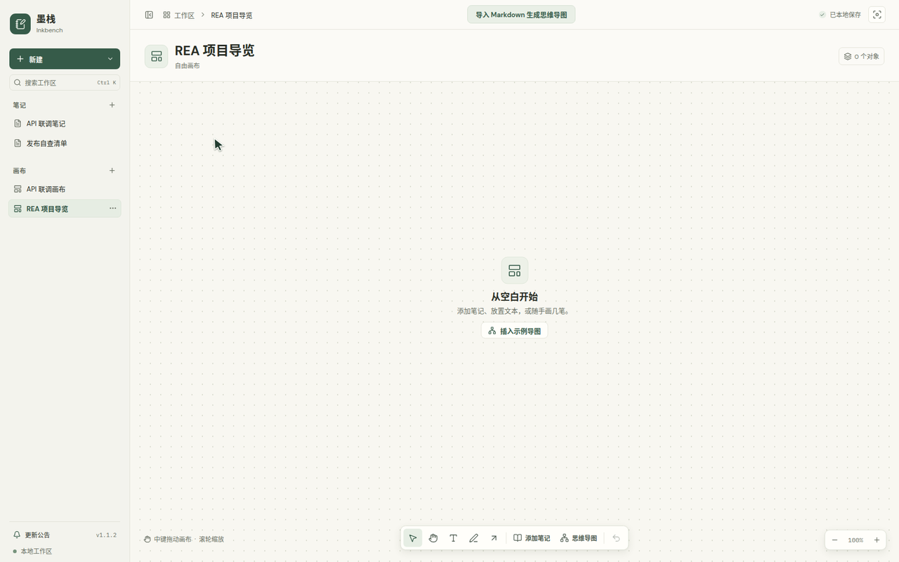

<p align="center">
  
</p>

<p align="center">
  <strong><a href="https://github.com/995916639a-coder/Inkbench/releases/latest">下载 Linux 版</a></strong>
  · <a href="#快速开始">快速开始</a>
  · <a href="update.md">更新公告</a>
</p>

在AI如此强大的今天，梳理代码仓库和层级调用思路的能力同样重要！

用墨栈记录排查步骤和代码，把笔记摆到同一张画布上，再用手绘标注或思维导图梳理思路。

## 界面预览

<p align="center">
  
  &nbsp;
  
  <br />
  <sub>可视化笔记（左） · API 联调画布（右）</sub>
</p>

<p align="center">
  
</p>

约 17 秒的演示使用一份根据 REA 公开文档整理的 Markdown 提纲。导入后生成 37 个节点，搜索「证据记录」，再将它改名为「分析证据」。[REA 公开文档](https://github.com/morluto/rea/tree/main/docs)

## 快速开始

在 Ubuntu 或 Debian 的 x86_64 电脑上，从 GitHub Releases 的 Assets 下载 `inkbench_1.2.1_amd64.deb`，然后在安装包所在目录运行以下命令。安装完成后，从系统应用菜单打开 Inkbench。[下载安装包](https://github.com/995916639a-coder/Inkbench/releases/latest)

```sh
sudo apt install ./inkbench_1.2.1_amd64.deb
```

### 开始记笔记

1. 在侧栏点击「新建」，选择笔记或画布。
2. 在笔记里直接输入文字，用正文上方的工具栏设置格式。
3. 在画布底部选择「添加笔记」「文本」或「画笔」。拖动卡片顶部可以移动对象，滚轮可以缩放画布。
4. 桌面版启动时最大化并保留系统标题栏。按 F11 或点击应用右上角的窗口按钮可最大化或还原窗口。
5. 点击工作台顶部的侧栏按钮，或按 `Ctrl+\\`，可以收起或展开文件列表。

点击侧栏左下角的齿轮打开设置，可以调整界面缩放。也可按 `Ctrl + +` 或 `Ctrl + =` 放大整个应用，`Ctrl + -` 缩小，`Ctrl + 0` 恢复到 100%。

在「设置 → 界面语言」可以选择简体中文或 English。

在侧栏的条目菜单里选择「重命名」。输入后点击输入框外或按 Enter 保存，按 Esc 取消。

### 导入 Markdown

- 导入为笔记时，点击「新建 → 导入 Markdown」选择文件。
- 导入到画布时，直接拖入文件，或点击「添加笔记 → 导入 Markdown 到画布」，选中文件后再点击放置位置。
- 生成导图时，从画布底部「思维导图 → 从 Markdown 生成」选择文件。

导入使用 UTF-8 编码，保留标题、列表和代码块等常用格式。表格、图片语法和 HTML 会保留为可编辑文本。

### 思维导图离线翻译

- 在桌面版选择「思维导图 → 翻译导图」。
- 首次选择「中文 → 英文」或「英文 → 中文」，点击「离线翻译」。译文直接显示在当前导图，之后可从同一菜单切换中英文。
- 节点位置、连线和配色会保留。中英模型随安装包交付，首次使用即可离线翻译。

## 功能介绍

- **可视化笔记**。直接编辑标题、段落、粗体、列表、链接、行内代码和带语言高亮的代码块。
- **Markdown 导入**。将本地 `.md` 或 `.markdown` 文件转换成可编辑的笔记或画布卡片。
- **自由画布**。放置文本框和笔记卡片，拖动对象，平移或缩放画布，也可以手绘和撤销最近一笔。
- **思维导图**。拖入椭圆或长方形节点，编辑、调整大小和连线。可以从 Markdown 生成导图，完成后导出为 PNG。
- **独立笔记副本**。笔记放到画布时复制标题和正文，卡片可以独立编辑。
- **本地工作区**。首次启动打开可编辑的示例画布，之后会自动保存，并在重启后恢复上次打开的内容。
- **工作区搜索**。按 Ctrl+K 可搜索笔记、画布内容和思维导图节点。

应用内可从侧栏左下角查看版本记录。[更新公告](update.md)

## 从源码预览

在项目目录使用 Node.js 24 和 npm 安装依赖，然后启动本地预览。

```sh
ONNXRUNTIME_NODE_INSTALL=skip npm ci
npm run dev
```

打开 [浏览器预览](http://127.0.0.1:5173/)。预览使用示例工作区，刷新后恢复初始内容。运行 `npm run package:linux` 可以在 `release/` 生成 Linux 安装包。
